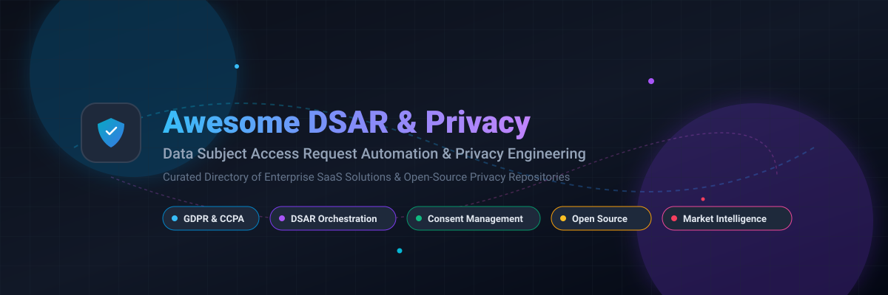

  

# 🛡️ Awesome Data Subject Access Request (DSAR) & Privacy Management

**A curated, production-grade directory of enterprise SaaS platforms, open-source privacy engineering tools, and developer frameworks for automated Data Subject Access Request (DSAR/DSR) fulfillment, RoPA compliance, and consent orchestration.**

  
  
  
  
  
  
  

---

## 🧭 Table of Contents
- [📌 Overview & Key Concepts](#-overview--key-concepts)
- [📊 Sector Overview & Market Dynamics](#-sector-overview--market-dynamics)
- [🏢 Enterprise SaaS Platforms](#-enterprise-saas-platforms)
- [💻 Open-Source Privacy & DSAR Projects](#-open-source-privacy--dsar-projects)
- [🤝 How to Contribute](#-how-to-contribute)
- [☕ Support](#-support)
- [📈 Star History](#-star-history)
- [⚖️ Disclaimer](#️-disclaimer)

---

## 📌 Overview & Key Concepts

Under international privacy regulations such as the European Union's **General Data Protection Regulation (GDPR Art. 12 & 15–22)**, the **California Consumer Privacy Act / CPRA**, and India's **DPDP Act**, individuals possess statutory rights over their personal data. These include:
- **Right to Access / Portability:** Receiving a copy of all personal information held across all internal databases and SaaS tools.
- **Right to Erasure ("Right to be Forgotten"):** Deleting personal information across primary databases, backups, caches, and third-party SaaS vendors.
- **Right to Rectification & Objection:** Correcting inaccurate data and opting out of automated profiling or data sales.

Fulfilling these requests manually across fragmented cloud databases, data lakes, CRM platforms, and payment processors within statutory deadlines (GDPR strictly mandates **30 calendar days**) introduces severe operational overhead and legal compliance risk. This repository tracks both category-leading **SaaS orchestration platforms** and **open-source privacy engineering engines** designed to automate discovery, identity verification, and multi-system data deletion/retrieval workflows.

---

## 📊 Sector Overview & Market Dynamics

The global data privacy and compliance software market is estimated at **$5.4B–$5.8B in 2025** and is projected to surpass **$7.5B by 2026**, expanding at a compound annual growth rate (CAGR) exceeding 30%. 

The competitive landscape is **moderately fragmented overall**, populated by hundreds of specialized niche vendors across consent management, data discovery, cookie compliance, and localized jurisdictions. However, the enterprise DSAR orchestration and Data Security Posture Management (DSPM) tier is **heavily concentrated at the top**, where a small tier of dominant category leaders (led by OneTrust, Securiti.ai, and BigID) capture over 30% of global market revenue.

---

## 🏢 Enterprise SaaS Platforms

Below is an overview of commercial SaaS platforms providing automated DSAR orchestration, data discovery, and privacy governance. 

*Sorted in descending order by enterprise company scale (valuation / annual revenue).*

| Product | Description | Scale (Valuation / Revenue) | Starting Tier Price | Free Tier / Free Trial Limits |
|---|---|---|---|---|
| **[OneTrust](https://www.oneTrust.com/)** | Enterprise trust & privacy management suite offering end-to-end DSAR lifecycle automation, continuous data mapping, consent banners, and regulatory assessment modules. | **$4.5B+ Valuation** / **~$550M+ ARR** | **$10,000/year** (baseline enterprise package) | **14-day sales-guided POC/trial** (limited evaluation environment; no self-serve free forever plan) |
| **[Securiti.ai](https://securiti.ai/)** | Unified Data Command Center combining Data Security Posture Management (DSPM), automated privacy request workflows, and AI governance. | **$1.725B Valuation** (Acquired by Veeam) / **~$100M+ ARR** | **$50,000/year** (median entry-level contract via marketplace/sales) | **14 to 30 days guided POC** (scoped per data connectors; freemium entry available for basic privacy center) |
| **[BigID](https://bigid.com/)** | ML-driven enterprise data intelligence and discovery platform automating DSAR fulfillment across 100+ on-premise and multi-cloud data sources. | **$1B+ Valuation** / **~$100M ARR** | **$525,000** (C4 Discovery Foundation Package, 3-year term) | **14 to 30 days scoped enterprise POC** (no self-serve free forever plan) |
| **[TrustArc](https://www.trustarc.com/)** | Modular privacy platform delivering Privacy Rights Automation, operational risk assessments, and compliance verification. | **$30M–$80M ARR** (Private, Established Leader) | **$30,000/year** (single module baseline deployment) | **30-day standard trial period** (per TrustArc Master Terms; no self-serve free forever plan) |
| **[DataGrail](https://www.datagrail.io/)** | Modern privacy platform with 2,000+ zero-code SaaS and database connectors for automated DSAR request fulfillment. | **~$200M Valuation** / **~$18M ARR** | **$30,000/year** (entry-level deployment for <1M data subjects and <500 DSARs/yr) | **Custom sales-scoped POC** (typically 14–30 days upon qualification; no self-serve free forever plan) |
| **[Transcend](https://transcend.io/)** | Modern privacy infrastructure platform providing automated data subject request orchestration and discovery directly inside databases. | **~$100M+ Valuation** / **~$16M ARR** | **$10,000/year** (entry-level base subscription) | **30-day standard evaluation/POC** (per Transcend Online Services Agreement Section 1.5; no free forever plan) |
| **[Osano](https://www.osano.com/)** | Privacy platform with consent management, vendor monitoring, and data subject rights automation; backed by a "No Fines Guarantee". | **~$100M Valuation** / **~$25M ARR** | **$0/month** (Developer/Solo tier) / **$199/month** (Plus plan) | **Free forever plan**: 1 user, 1 domain, up to 5,000 monthly visitors; **30-day free trial** available for Plus plan |
| **[Mine PrivacyOps](https://www.mineprivacy.com/)** | Privacy operations platform (MineOS) providing continuous data mapping, AI asset governance, and automated DSAR request processing. | **~$50M+ Est. Valuation** (Raised $40M+) / **Multi-Millions ARR** | **$0/month** (Free tier) / **$8,000/year** (paid tier entry) | **Free forever plan**: up to 2 seats and 5 evidence-backed DSR requests per month (full API automation requires paid plan) |
| **[WireWheel](https://www.wirewheel.io/)** | Privacy compliance orchestration platform covering DSAR fulfillment, assessment workflows, and vendor trust (Acquired by Osano). | **~$45M Total Funding** / **~$8M ARR** | **$12,000/year** (entry-level small-business package via AWS Marketplace) | **30-day free trial** (for UPCP/consent products; guided POC for full enterprise DSAR platform) |
| **[Ketch](https://www.ketch.com/)** | Privacy UX and programmatic data rights automation platform designed for modern applications and rapid deployment. | **~$43M Total Funding** / **~$10M–$14M ARR** | **$0/month** (Free consent tier) / **$150/month** (Starter tier) | **Free forever plan**: up to 5,000 monthly visitors (consent management; automated DSAR requires Pro tier) |

---

## 💻 Open-Source Privacy & DSAR Projects

Curated self-hosted software and developer libraries for handling data subject requests, managing PII vaults, tracking regulatory deadlines, and implementing consent banners.

*Sorted in descending order by GitHub_Stars.*

| Project | Stars_Badge | Description | License |
|---|---|---|---|
| **[c15t](https://github.com/c15t/c15t)** |  | Open-source cookie consent manager and GDPR cookie banner for React, Next.js, Vue, and vanilla JavaScript. Full support for Google Consent Mode v2 and IAB TCF frameworks. | MIT |
| **[DataBunker](https://github.com/securitybunker/databunker)** |  | Secure, developer-friendly vault for customer PII/PHI/KYC records built for GDPR compliance. Features built-in user identity tokenization, access logs, and an API for DSAR personal data lookup and erasure. | Apache-2.0 |
| **[tarteaucitron.js](https://github.com/AmauriC/tarteaucitron.js)** |  | Lightweight European GDPR/RGPD consent manager script. Blocks third-party tracking scripts prior to explicit consent with zero backend dependencies. | MIT |
| **[gdpr-checklist](https://github.com/privacyradius/gdpr-checklist)** |  | Interactive, actionable compliance guide and developer checklist covering GDPR Article 12–23 rights, privacy policy drafting, and security measures. | MIT |
| **[Fides (Ethyca)](https://github.com/ethyca/fides)** |  | **The primary open-source privacy engineering engine for DSAR orchestration.** Connects directly into production databases and SaaS APIs to discover personal data and automate GDPR/CCPA access and erasure requests. | Apache-2.0 |
| **[ConsentOS](https://github.com/consentos/consentos)** |  | Self-hosted consent management platform (CMP). Preserves consent records in your internal database with no per-domain fees, auto-blocking, and IAB TCF v2.3 compliance. | Elastic-2.0 |
| **[gdprkit](https://github.com/cognis-digital/gdprkit)** |  | Self-hosted CLI and Python toolkit for GDPR/CCPA DSAR tracking, statutory 30-day deadline alerts, RoPA (Article 30) validation, and cookie audits. | MIT |
| **[privacy-dsar-mcp-server](https://github.com/AiAgentKarl/privacy-dsar-mcp-server)** |  | Model Context Protocol (MCP) server for GDPR DSAR management and 30-day deadline tracking. Provides local storage-backed AI agent tools for managing compliance workflows. | MIT |

---

## 🤝 How to Contribute

Contributions are warmly welcomed! Help build the most accurate and up-to-date guide to privacy engineering:

1. 🍴 **Fork** this repository.
2. 🌿 Create a feature branch: `git checkout -b feature/add-privacy-tool`
3. ✏️ Add your project or update existing details in [README.md](file:///C:/Users/ishan/Documents/Projects/Awesome-Data-Subject-Access-Request-DSAR-Privacy/README.md).
   - Ensure SaaS entries follow the pricing format with transparent starting costs and explicit trial limits.
   - For open-source projects, include the official GitHub Stars_Badge linking to the stargazers page.
4. 🚀 Commit your changes: `git commit -m "Add [Tool Name] to DSAR ecosystem"`
5. 📬 Push to your branch and open a **Pull Request**.

---

## ☕ Support

If you find this repository helpful for your compliance operations, privacy engineering, or open-source research, please consider supporting the project!

- ⭐ **Star this repository** to help others discover it.
- 🍴 **Fork and contribute** to keep entries accurate and comprehensive.
- 📢 **Share** with privacy engineers, compliance officers, and developers in your network.
- ☕ **Sponsor the Maintainer**: Support continuous open-source maintenance by buying a coffee via the [GitHub Sponsors Dashboard](https://github.com/sponsors/ishandutta2007).

---

## 📈 Star History

---

## ⚖️ Disclaimer

- This list is community-curated for informational and educational purposes only; it does not constitute formal legal counsel.
- Data Subject Access Requests (DSARs) and data deletion procedures process sensitive personal information (PII) under strict regulatory timelines (e.g., GDPR Art. 12 one-month statutory mandate). Always conduct legal and security reviews before deploying software into production environments.
